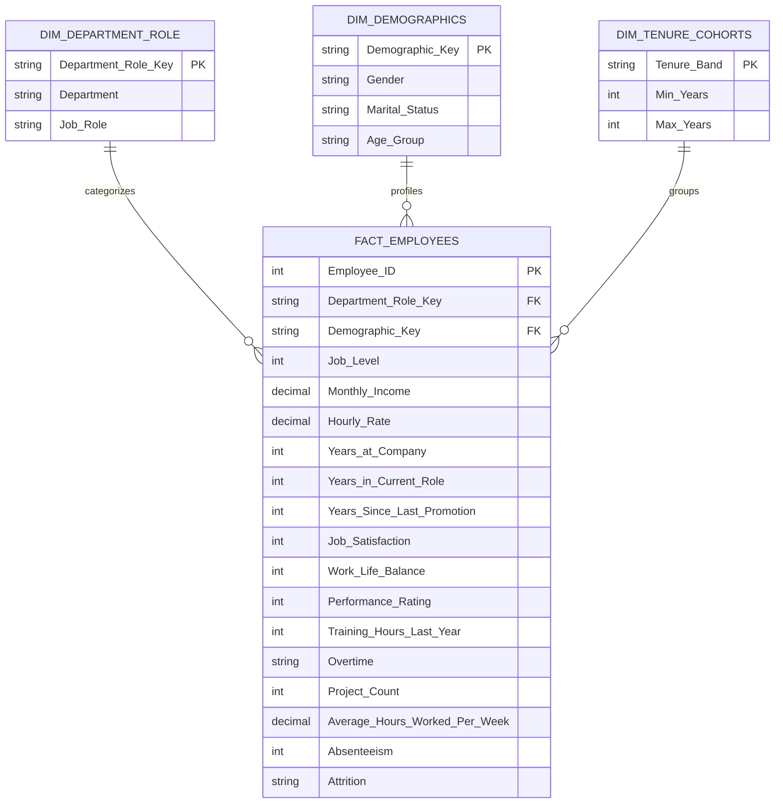

# Power BI Data Model Architecture: HR Analytics & Workforce Attrition

The HR Analytics dashboard is structured around an optimized **People Analytics Schema** designed for departmental drill-downs, turnover cohort analysis, and compensation benchmarking.

---

## Relationship Specifications
1. **`Dim_Department_Role[Department_Role_Key]` $\xrightarrow{1:M}$ `Fact_Employees[Department_Role_Key]`**
   - Cardinality: One-to-Many ($1:*$)
   - Cross-filter direction: Single
2. **`Dim_Demographics[Demographic_Key]` $\xrightarrow{1:M}$ `Fact_Employees[Demographic_Key]`**
   - Cardinality: One-to-Many ($1:*$)
   - Cross-filter direction: Single
3. **`Dim_Tenure_Cohorts[Tenure_Band]` $\xrightarrow{1:M}$ `Fact_Employees[Tenure_Band]`**
   - Cardinality: One-to-Many ($1:*$)
   - Cross-filter direction: Single
